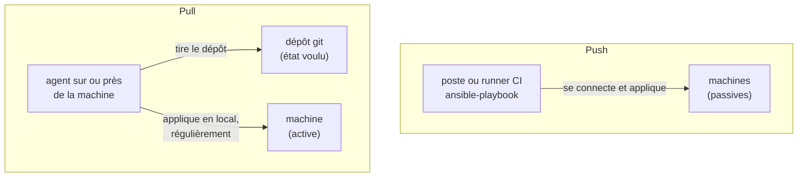
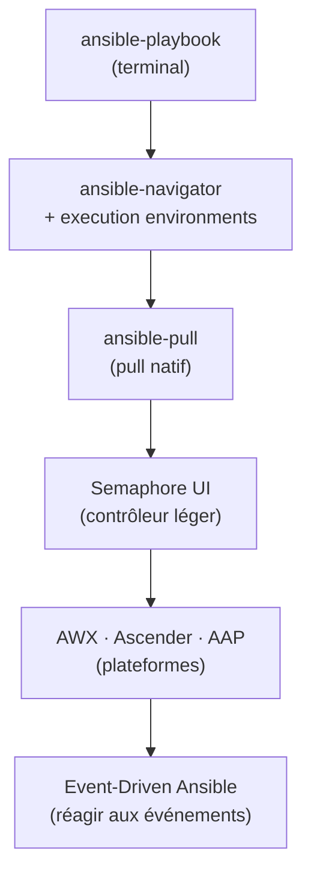

## Un playbook, et après ?

Sur votre poste, `ansible-playbook -i inventory.ini site.yml` suffit : vous avez l'inventaire, les
collections, les mots de passe, et vous voyez le résultat défiler. Dès qu'une **équipe** partage
ces playbooks, et qu'ils configurent de vraies machines, six questions apparaissent, auxquelles la
commande seule ne répond pas :

| Besoin | La question concrète |
|---|---|
| **Reproductibilité** | le playbook marche chez moi ; marchera-t-il chez un collègue, avec sa version d'Ansible et ses collections ? |
| **Déclenchement** | qui lance le playbook, et quand : à la main, à heure fixe, à chaque commit, à chaque alerte ? |
| **Secrets** | où vivent les mots de passe et les clés SSH, et qui peut s'en servir sans les lire ? |
| **Droits** | qui a le droit de lancer quel playbook, sur quel inventaire ? la production n'est pas la recette |
| **Traçabilité** | qui a lancé quoi, quand, avec quel résultat ? dans six mois, il faudra pouvoir répondre |
| **Interface** | un terminal convient à l'auteur du playbook ; un collègue de l'exploitation préfère souvent un bouton |

Chaque outil de ce cours répond à une partie de ces questions, et aucun n'y répond gratuitement :
plus l'outil en couvre, plus il est lourd à installer et à maintenir. C'est ce compromis que le
cours vous apprend à juger.

## Push ou pull

Deux façons de faire converger une machine vers l'état décrit dans le dépôt s'opposent. En
**push**, un poste (le vôtre, ou un runner de CI) se connecte aux machines et **pousse** la
configuration : c'est le fonctionnement par défaut d'Ansible. En **pull**, la machine, ou un agent
placé à côté d'elle, **va chercher** elle-même la configuration dans le dépôt, et la réapplique
régulièrement.



Le pull a un avantage décisif : la machine **revient seule** à l'état voulu, même si personne ne
pousse rien. Une modification faite à la main, une **dérive**, est corrigée au passage suivant.
C'est la **réconciliation continue**, au cœur de ce qu'on appelle GitOps.

Une nuance évite bien des confusions. Un **contrôleur** comme Semaphore ou AWX **tire le dépôt**,
puis **pousse** la configuration vers des machines qui restent passives, par SSH le plus souvent.
Lancé par un planning, il obtient la même réconciliation qu'un vrai pull, sans rien installer sur
les machines : on parle souvent de GitOps côté contrôleur. Seul ansible-pull fait tirer le dépôt
**par la machine elle-même**.

| | Push | Pull |
|---|---|---|
| Qui agit | un poste extérieur | la machine, ou un agent proche |
| Quand | quand quelqu'un (ou un pipeline) lance | à intervalle régulier, ou sur un nouveau commit |
| Accès réseau | le poste doit joindre toutes les machines | chaque machine doit joindre le dépôt |
| Dérive | corrigée seulement au prochain lancement manuel | corrigée automatiquement au cycle suivant |
| Outils de ce cours | ansible-playbook, ansible-navigator ; Semaphore et AWX, qui tirent le dépôt puis poussent | ansible-pull |

## Quatre façons de déclencher

Que l'on pousse ou que l'on tire, il faut décider **quand** le playbook tourne. Quatre
déclencheurs reviennent dans tous les outils :

| Déclencheur | Exemple | Ce qu'il corrige |
|---|---|---|
| **manuel** | un clic sur « Run », une commande | ce qu'on pense à corriger |
| **planifié** (cron) | toutes les 15 minutes | les dérives, même sans changement du dépôt |
| **sur commit** | dès qu'un nouveau commit arrive dans le dépôt | les changements voulus, vite ; mais pas une dérive seule |
| **sur événement** | une alerte de supervision, un webhook | une situation précise, au moment où elle survient |

Retenez la troisième ligne, elle surprend souvent : un déclenchement **sur commit** ne corrige pas
une dérive tant que le dépôt ne change pas. Vous le constaterez avec `ansible-pull`, et le
retrouverez dans les options de Semaphore.

## L'échelle des outils

Les outils de ce cours se rangent sur une échelle : chaque marche ajoute des réponses aux six
besoins, et du poids.



| Marche | Ce qu'elle ajoute | Ce qu'il faut pour l'héberger |
|---|---|---|
| ansible-navigator | une exécution **reproductible** dans une image, une interface en mode texte, un historique des exécutions | rien de plus que votre poste (et Docker ou Podman pour les images) |
| ansible-pull | le **pull** et la **réconciliation**, sans aucun serveur | git et Ansible sur chaque machine |
| Semaphore UI | une **interface web**, des **plannings**, des **secrets** stockés, des équipes, une **API** | un conteneur et une base de données |
| AWX, Ascender, AAP | des **droits fins**, des **workflows**, l'**audit**, des exécutions à grande échelle | un cluster Kubernetes (ou l'installeur de l'éditeur) |
| Event-Driven Ansible | le déclenchement **sur événement** | une brique en plus de la plateforme |

Il vaut mieux choisir la marche la plus basse qui répond à vos besoins : une petite équipe sans
exigence d'audit n'a aucune raison d'héberger un cluster Kubernetes pour lancer trois playbooks.

## Testez-vous

```quiz
title: Du terminal à la plateforme — validation
tracksProgress: true
submitMode: last-only
questions:
  - prompt: Quel besoin répond à la question « marchera-t-il chez un collègue, avec sa version d'Ansible et ses collections ? »
    answers:
      - "La traçabilité"
      - "La reproductibilité"
      - "Les droits"
      - "Le déclenchement"
    correct: 2
    explanation: |
      Un playbook dépend d'une version d'Ansible, de collections et de bibliothèques Python. Les
      execution environments, au chapitre 2, figent cet ensemble dans une image.
  - prompt: Quelle est la différence essentielle entre push et pull ?
    answers:
      - "Le push utilise SSH, le pull utilise HTTP"
      - "En push, un poste extérieur applique la configuration ; en pull, la machine (ou un agent proche) va la chercher et l'applique"
      - "Le pull est réservé à Kubernetes"
      - "Le push est plus sûr car il ne demande aucun accès réseau"
    correct: 2
    explanation: |
      Tout tient au sens de l'initiative. Le pull n'est pas réservé à Kubernetes : ansible-pull
      le pratique sans aucun serveur.
  - prompt: Un playbook est déclenché à chaque nouveau commit. Quelqu'un modifie un fichier à la main sur la machine. Que se passe-t-il ?
    answers:
      - "La dérive est corrigée dans la minute"
      - "Rien, tant qu'aucun nouveau commit n'arrive dans le dépôt"
      - "Le dépôt est mis à jour avec la modification"
      - "Le playbook échoue"
    correct: 2
    explanation: |
      Un déclenchement sur commit réagit aux changements du dépôt, pas à l'état de la machine.
      Pour corriger une dérive sans commit, il faut un déclenchement planifié.
  - prompt: Quels besoins un contrôleur web comme Semaphore ajoute-t-il par rapport à ansible-playbook seul ? (plusieurs réponses)
    answers:
      - "Des plannings"
      - "Des secrets stockés et utilisables sans être lus"
      - "L'écriture automatique des playbooks"
      - "Une interface web et une API"
    correct: [1, 2, 4]
    explanation: |
      Un contrôleur organise l'exécution ; il n'écrit pas les playbooks à votre place.
  - prompt: Une équipe de trois personnes, sans exigence d'audit, veut lancer chaque nuit deux playbooks. Que faut-il éviter en priorité ?
    answers:
      - "Un planning dans Semaphore"
      - "Une tâche cron avec ansible-pull"
      - "Héberger un cluster Kubernetes pour installer une plateforme complète"
      - "Un pipeline de CI planifié"
    correct: 3
    explanation: |
      Les trois autres options répondent au besoin avec peu d'infrastructure. Une plateforme
      sur Kubernetes ne se justifie qu'avec des besoins de droits fins, d'audit ou d'échelle.
```
