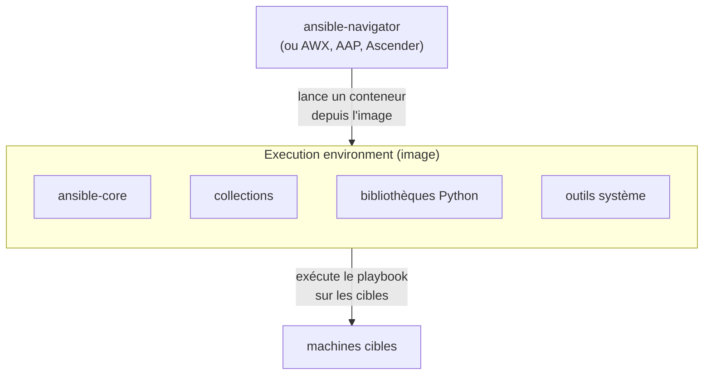

## ansible-playbook, en mieux équipé

`ansible-navigator run site.yml` fait ce que fait `ansible-playbook site.yml`, avec trois ajouts :

| Ajout | Ce qu'il apporte |
|---|---|
| **une interface en mode texte** (TUI) | on navigue dans l'exécution : la liste des plays, puis les tâches d'un play, puis le détail complet d'une tâche |
| **les execution environments** | le playbook tourne dans une image de conteneur qui contient Ansible, les collections et les bibliothèques Python ; le résultat ne dépend plus de votre poste |
| **les artifacts** | chaque exécution est enregistrée dans un fichier JSON, qu'on peut **rejouer** plus tard dans l'interface, pour l'examiner ou le partager |

navigator sait aussi parcourir les collections installées, la documentation des modules ou le
contenu d'une image, avec les sous-commandes `collections`, `doc` et `images`. Il fonctionne en deux
**modes** : `interactive` (l'interface en mode texte, par défaut) et `stdout` (une sortie
classique, comme `ansible-playbook`, pratique dans un script ou une CI).

> 📖 [Documentation d'ansible-navigator](https://docs.ansible.com/projects/navigator/)

## L'interface en mode texte

Une démonstration en vidéo montre la navigation au clavier :
[ansible-navigator en action (asciinema)](https://asciinema.org/a/gl7uVblC23dxGGTkVOEigDHCl).

Voici les trois écrans que vous verrez à l'étape suivante, relevés sur un vrai lancement. Le premier
liste les **plays** de l'exécution, avec leurs compteurs :

```text
  Play name       Ok Changed Unreachable  Failed Skipped Ignored In progress  Task count   Progress
0│Démo navigator   1       0           0       0       0       0           0           1   Complete

^b/PgUp page up   ^f/PgDn page down   ↑↓ scroll   esc back   [0-9] goto   :help help    Successful
```

En tapant le numéro d'un play (`0`), on descend dans ses **tâches** :

```text
  Result   Host         Number   Changed   Task             Task action                 Duration
0│Ok       localhost         0   False     Dire bonjour     ansible.builtin.debug             0s
```

Puis, avec le numéro d'une tâche, dans son **détail** : tout ce que le module a renvoyé, que
`ansible-playbook` n'affiche qu'avec `-vvv`.

```text
Play name: Démo navigator:0
Task name: Dire bonjour
Ok: localhost Bonjour depuis ansible-navigator
 0│---
 1│duration: 0.011791
 4│host: localhost
 9│res:
11│  changed: false
12│  msg: Bonjour depuis ansible-navigator
13│resolved_action: ansible.builtin.debug
```

La barre du bas rappelle les touches : un **chiffre** pour descendre, **Échap** pour remonter,
`:q` pour quitter, `:help` pour l'aide.

## Les execution environments

Un playbook dépend de beaucoup plus que de son fichier : une version d'`ansible-core`, des
collections (`community.docker`, `community.general`…) et des bibliothèques Python (`passlib`,
`docker`…). Sur le poste de chacun, ces versions divergent, et le même playbook se comporte
différemment. Un **execution environment** (EE) règle le problème en figeant tout cet ensemble dans
une **image de conteneur** :



| Avec un EE | Sans EE (`--ee false`) |
|---|---|
| Ansible et ses dépendances viennent de l'**image** | Ansible et ses dépendances viennent de **votre poste** |
| même résultat chez tout le monde, en CI et dans AWX | résultat dépendant de chaque poste |
| il faut Docker ou Podman, et télécharger l'image | rien de plus que navigator |

Les images se construisent avec **ansible-builder**, à partir d'un fichier `execution-environment.yml`
qui liste l'image de base, les collections et les paquets Python voulus. Une image générique est
fournie par la communauté : `ghcr.io/ansible/community-ansible-dev-tools`, que navigator utilise par
défaut.

Un point déroute souvent au premier usage : **dans un EE, `localhost` désigne le conteneur de
l'EE**, pas votre poste. Un playbook qui écrit un fichier sur `localhost` l'écrit donc dans un
conteneur éphémère, qui disparaît à la fin de l'exécution.

> 📖 [Démarrer avec les execution environments](https://docs.ansible.com/projects/ansible/latest/getting_started_ee/index.html) ·
> [ansible-builder](https://docs.ansible.com/projects/builder/)

## Testez-vous

```quiz
title: Navigator et EE — entraînement
tracksProgress: false
showNotice: false
questions:
  - prompt: Que contient un execution environment ?
    answers:
      - "Seulement vos playbooks"
      - "ansible-core, des collections, des bibliothèques Python et des outils système, dans une image de conteneur"
      - "Un inventaire et des secrets"
    correct: 2
    explanation: |
      L'EE transporte l'environnement d'exécution, pas le contenu du projet : playbooks et
      inventaires restent dans votre dépôt.
  - prompt: Dans un execution environment, sur quoi agit une tâche qui vise localhost ?
    answers:
      - "Sur votre poste"
      - "Sur le conteneur de l'EE, qui disparaît à la fin de l'exécution"
      - "Sur la première machine de l'inventaire"
    correct: 2
    explanation: |
      Le playbook s'exécute dans le conteneur : `localhost` est ce conteneur.
```
