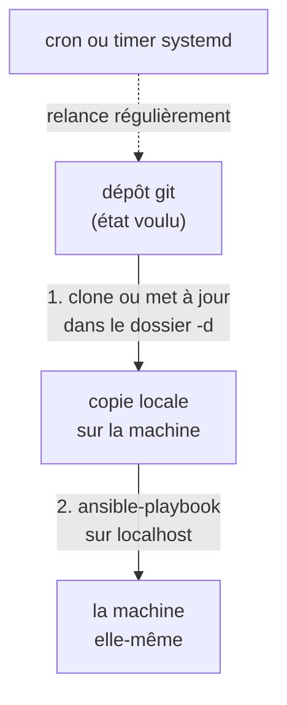

## Cloner, appliquer, recommencer

Une exécution d'`ansible-pull` enchaîne deux étapes, toujours sur la machine elle-même :



1. il **clone** le dépôt (ou le met à jour s'il est déjà là) dans un dossier local ;
2. il **lance le playbook** qu'il y trouve, contre la machine elle-même (`localhost`).

Il n'y a ni connexion SSH entrante, ni serveur central : chaque machine n'a besoin que de **git**,
d'**Ansible** et d'un **accès au dépôt**. C'est ce qui rend ansible-pull intéressant pour des
machines nombreuses, éphémères ou difficiles à joindre depuis l'extérieur (derrière un NAT, au
démarrage d'une image cloud).

## Les options à connaître

Une commande typique ressemble à ceci :

```bash
# Exemple, à ne pas lancer ici
ansible-pull -U https://git.example.com/ops/config.git -C main -d /var/lib/ansible-pull site.yml
```

| Option | Rôle |
|---|---|
| `-U` (`--url`) | l'URL du dépôt à cloner ; un chemin local fonctionne aussi |
| `-C` (`--checkout`) | la branche, le tag ou le commit à utiliser |
| `-d` (`--directory`) | le dossier où cloner le dépôt sur la machine |
| `site.yml` | le playbook à lancer ; sans argument, ansible-pull cherche `<nom complet de la machine>.yml`, puis `<nom court>.yml`, puis `local.yml` |
| `-i` | un inventaire ; sans lui, ansible-pull vise `localhost` et le nom de la machine |
| `-o` (`--only-if-changed`) | ne lance le playbook **que si** le dépôt a changé depuis le dernier passage |
| `-s` (`--sleep`) | attend un délai aléatoire avant de commencer, pour que mille machines ne frappent pas le dépôt à la même seconde |

> 📖 [La commande ansible-pull](https://docs.ansible.com/ansible/latest/cli/ansible-pull.html)

## Le planifier

ansible-pull ne tourne pas tout seul en boucle : on le confie au planificateur de la machine. Avec
**cron**, une ligne suffit, ici toutes les 15 minutes, avec un journal :

```bash
# Exemple de ligne de crontab (crontab -e), à ne pas lancer ici
*/15 * * * * ansible-pull -U https://git.example.com/ops/config.git -d /var/lib/ansible-pull site.yml >> /var/log/ansible-pull.log 2>&1
```

Sur une distribution récente, un **timer systemd** fait le même travail, avec en prime le journal
dans `journalctl`, et, avec l'option `Persistent=true`, un rattrapage si la machine était éteinte à
l'heure prévue. Dans l'exercice qui
suit, une simple boucle `while` dans le conteneur jouera le rôle de cron, pour aller plus vite.

## ansible-pull ou un contrôleur ?

ansible-pull apporte le pull et la réconciliation, mais **rien d'autre** : pas d'interface, pas de
vue d'ensemble des exécutions, pas de gestion des secrets. Chaque machine écrit son propre journal,
dans son coin.

| | ansible-pull | Un contrôleur (Semaphore, AWX…) |
|---|---|---|
| Où tourne Ansible | sur **chaque** machine | sur le contrôleur, qui joint les machines |
| Infrastructure | aucune | un service et une base de données, au minimum |
| Vue d'ensemble | aucune : un journal par machine | un historique central de toutes les exécutions |
| Secrets | à déposer sur chaque machine | stockés une fois, dans le contrôleur |
| Bon usage | machines nombreuses ou éphémères, démarrage d'images | équipe qui veut voir, planifier et déléguer |

## Testez-vous

```quiz
title: ansible-pull — entraînement
tracksProgress: false
showNotice: false
questions:
  - prompt: Sur quelle machine Ansible s'exécute-t-il avec ansible-pull ?
    answers:
      - "Sur un poste de contrôle central"
      - "Sur chaque machine configurée, contre elle-même"
      - "Sur le serveur qui héberge le dépôt git"
    correct: 2
    explanation: |
      Chaque machine clone le dépôt et s'applique le playbook. Il faut donc Ansible et git sur
      chacune.
  - prompt: À quoi sert l'option -s (--sleep) ?
    answers:
      - "À attendre la fin du playbook"
      - "À étaler dans le temps les accès au dépôt quand beaucoup de machines démarrent ensemble"
      - "À ralentir l'exécution des tâches"
    correct: 2
    explanation: |
      Un délai aléatoire évite que toutes les machines clonent le dépôt à la même seconde.
```
