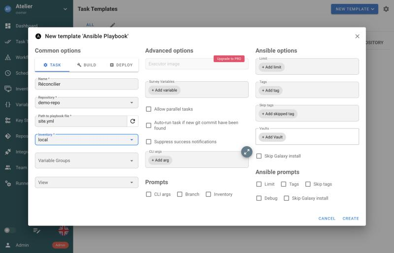
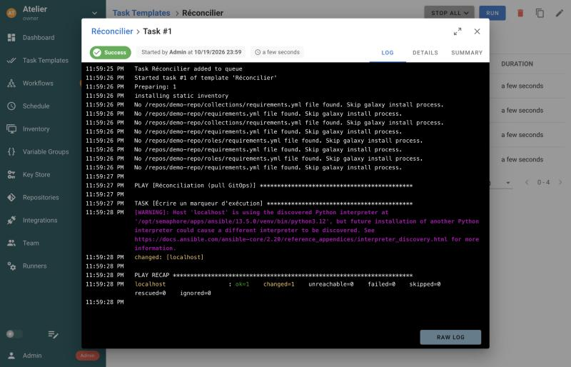

## Le modèle d'un contrôleur

Brancher un dépôt ne suffit pas : un contrôleur n'y lit **que du code**, des playbooks. Un
`site.yml` seul est ambigu : le jouer sur la production ou sur la recette ? avec quels identifiants ?
quand ? Ces réponses sont des **objets** que vous déclarez dans le contrôleur. Semaphore en compte
quatre principaux, qui ont tous leur équivalent dans AWX :

| Objet Semaphore | Équivalent AWX | Ce qu'il dit |
|---|---|---|
| **Key Store** | *Credential* | avec quels identifiants : clé SSH, mot de passe, mot de passe de vault |
| **Repository** | *Project* | **où** chercher le code : l'URL du dépôt git et la branche |
| **Inventory** | *Inventory* | **sur quoi** jouer |
| **Task Template** | *Job Template* | **quoi** jouer : un playbook, d'un dépôt, sur un inventaire |

Un cinquième objet, le **Schedule** (*Schedule* dans AWX aussi), dira **quand** à l'étape suivante.
Cette séparation est une force : le même playbook sert plusieurs environnements, en ne changeant
que l'inventaire et les identifiants dans le template.

> 📖 [Semaphore : guide d'utilisation](https://docs.semaphoreui.com/user-guide/projects/)

## Le projet et la clé

Tout objet de Semaphore appartient à un **projet**. Au premier lancement, l'interface vous propose
d'en créer un : nommez-le `Atelier`, puis validez. Si elle ne le propose pas, utilisez le menu
déroulant en haut à gauche, puis **New project**.

Ouvrez ensuite **Key Store** dans le menu de gauche : une clé nommée **None** y existe déjà, créée
avec le projet. C'est celle que vous utiliserez partout : le dépôt est local et la cible est la
machine elle-même, aucun identifiant n'est nécessaire. Sur un vrai projet, vous y rangeriez une clé
SSH de déploiement ou le mot de passe d'Ansible Vault, que les utilisateurs utilisent sans jamais
les lire. Pour qu'ils soient aussi **chiffrés en base**, Semaphore attend une clé de chiffrement dans
la variable `SEMAPHORE_ACCESS_KEY_ENCRYPTION` ; ce lab ne la définit pas, un déploiement réel doit
le faire.

```verify
pw=$(grep '^ADMIN_PASSWORD=' atelier/semaphore/.env 2>/dev/null | cut -d= -f2-); pw=${pw:-changeme}
c=$(mktemp); trap 'rm -f "$c"' EXIT
if ! curl -sf -c "$c" -X POST http://127.0.0.1:28030/api/auth/login -H 'Content-Type: application/json' \
     -d "{\"auth\":\"admin\",\"password\":\"$pw\"}" -o /dev/null; then
  echo "connexion à l'API de Semaphore impossible : Semaphore tourne-t-il (étape précédente) ?"; exit 1
fi
n=$(curl -s -b "$c" http://127.0.0.1:28030/api/projects | python3 -I -c 'import sys, json; print(len(json.load(sys.stdin)))')
if [ "$n" -ge 1 ]; then echo "$n projet(s) dans Semaphore"; else echo "aucun projet : créez le projet Atelier"; exit 1; fi
```

## Le dépôt

Ouvrez **Repositories**, puis **New Repository**, et remplissez :

| Champ | Valeur | Pourquoi |
|---|---|---|
| Name | `demo-repo` | un nom pour s'y retrouver |
| URL or path | `/repos/demo-repo` | le chemin **dans le conteneur**, monté par le `compose.yml` |
| Branch / Tag | (grisé) | pour un chemin local, Semaphore prend la branche courante du dépôt |
| Access Key | `None` | aucun identifiant pour un dépôt local |

Sous le champ d'URL, Semaphore rappelle les formes acceptées : `ssh`, `http`, `https`, `file`,
`git`, et un chemin absolu local. En entreprise, ce serait une URL `https://` ou `ssh://` vers
GitLab ou GitHub, avec une clé de déploiement en lecture seule.

## L'inventaire

Ouvrez **Inventory**, puis **New Inventory** et **Ansible Inventory** :

| Champ | Valeur |
|---|---|
| Name | `local` |
| User Credentials | `None` |
| Sudo Credentials | (vide) |
| Type | `Static` |

Le type `Static` ouvre un éditeur ; saisissez l'inventaire, qui vise la machine qui exécute le
playbook, c'est-à-dire le conteneur de Semaphore :

```ini
[local]
localhost ansible_connection=local
```

Le type `File` désignerait plutôt un fichier d'inventaire **du dépôt** : c'est la bonne pratique
quand l'inventaire est versionné avec les playbooks.

## Le template

Ouvrez **Task Templates**, puis **New template** et **Ansible Playbook**. Le menu montre au passage
que Semaphore sait aussi lancer du Terraform, de l'OpenTofu, du Terragrunt ou un script bash.
Remplissez les quatre champs obligatoires, marqués d'un astérisque :

| Champ | Valeur |
|---|---|
| Name | `Réconcilier` |
| Repository | `demo-repo` |
| Path to playbook file | `site.yml` |
| Inventory | `local` |

Le formulaire rempli ressemble à ceci :



Les autres champs sont facultatifs. Vous retrouverez à l'étape suivante l'un d'eux, la case
**Auto-run task if new git commit have been found**. Cliquez sur **Create**.

```verify
pw=$(grep '^ADMIN_PASSWORD=' atelier/semaphore/.env 2>/dev/null | cut -d= -f2-); pw=${pw:-changeme}
c=$(mktemp); trap 'rm -f "$c"' EXIT
curl -sf -c "$c" -X POST http://127.0.0.1:28030/api/auth/login -H 'Content-Type: application/json' \
  -d "{\"auth\":\"admin\",\"password\":\"$pw\"}" -o /dev/null || { echo "connexion à l'API impossible"; exit 1; }
python3 -I - "$c" <<'PY'
import json, subprocess, sys
cookie = sys.argv[1]
def get(path):
    out = subprocess.run(["curl", "-s", "-b", cookie, "http://127.0.0.1:28030/api" + path], capture_output=True, text=True).stdout
    return json.loads(out or "null") or []
for p in get("/projects"):
    repos = {r["id"]: r for r in get(f"/project/{p['id']}/repositories")}
    for t in get(f"/project/{p['id']}/templates"):
        repo = repos.get(t.get("repository_id"), {})
        if t.get("playbook") == "site.yml" and repo.get("git_url") == "/repos/demo-repo":
            print(f"template « {t['name']} » trouvé dans le projet « {p['name']} » : site.yml depuis /repos/demo-repo")
            sys.exit(0)
print("aucun template ne lance site.yml depuis le dépôt /repos/demo-repo : vérifiez le dépôt (URL or path) et le template")
sys.exit(1)
PY
```

## Lancer la tâche

Sur la ligne du template, cliquez sur le bouton ▶. Une fenêtre propose deux options, **Dry Run**
(`--check`, simuler sans rien changer) et **Diff** (`--diff`, montrer les différences) ; laissez-les
décochées et cliquez sur **Run**. Le journal de la tâche s'affiche en direct :



Deux détails du journal méritent l'attention. Semaphore cherche d'abord des fichiers
`requirements.yml` dans le dépôt, pour installer des rôles et collections : c'est le même
mécanisme que `ansible-galaxy install -r`. Et il exécute le playbook avec **son propre Ansible**,
embarqué dans l'image, et non celui de votre poste.

Vérifiez que le playbook a bien tourné dans le conteneur de Semaphore :

```exec
label: Lire le fichier témoin
---
docker compose -f atelier/semaphore/compose.yml -p layers-semaphore exec -T semaphore cat /tmp/gitops-reconcile.txt
```

La réponse est `réconcilié par Semaphore`. L'option `-T` évite d'allouer un terminal à la
commande, inutile ici.

```verify
out=$(docker compose -f atelier/semaphore/compose.yml -p layers-semaphore exec -T semaphore cat /tmp/gitops-reconcile.txt 2>/dev/null < /dev/null)
case "$out" in
  *"réconcilié"*) echo "le fichier témoin existe dans le conteneur de Semaphore : la tâche a tourné" ;;
  *) echo "pas de fichier témoin dans le conteneur : la tâche a-t-elle réussi ? (journal dans Task Templates)"; exit 1 ;;
esac
```

```hint
Une tâche en échec avec `fatal: repository '/repos/demo-repo' does not exist`, ou un message
`dubious ownership` : vérifiez les deux montages `./demo-repo` et `./gitconfig` du `compose.yml`, que
`atelier/semaphore/gitconfig` existe, puis redémarrez avec `up -d`.
```
