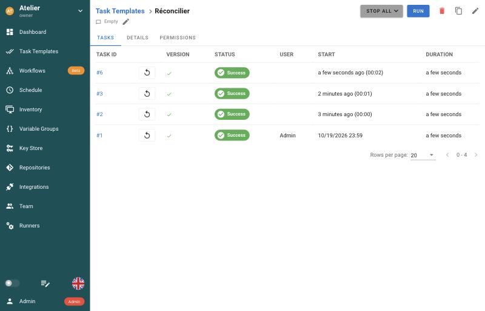
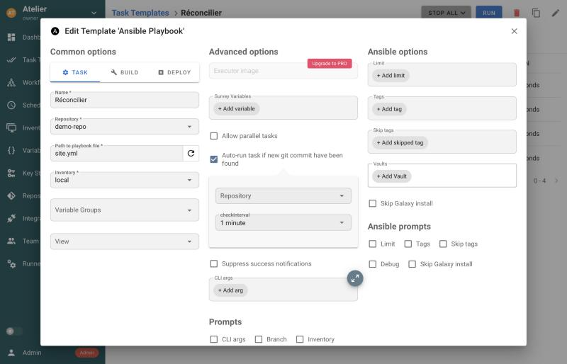

## Un planning

Un lancement manuel ne se distingue guère d'un `ansible-playbook` : quelqu'un clique. Ce qui donne
à un contrôleur la **réconciliation continue**, c'est qu'il revient **tout seul** tirer le dépôt et
réappliquer l'état voulu. Ouvrez **Schedule**, puis
**New Schedule** et **Cron**, et remplissez :

| Champ | Valeur |
|---|---|
| Name | `chaque minute` |
| Template | `Réconcilier` |
| Cron | `* * * * *` |
| Enabled | coché |

L'expression cron `* * * * *` signifie « chaque minute » : c'est volontairement court, pour
l'exercice. La fenêtre affiche la prochaine échéance, en UTC et à l'heure locale ; sur un vrai
serveur, on choisirait plutôt `*/15 * * * *` (toutes les 15 minutes) ou une fois par nuit. Cliquez
sur **Save**, puis attendez une minute : une nouvelle tâche apparaît dans l'historique du template,
lancée sans vous, et sans nom d'utilisateur dans la colonne **User**.



```verify
pw=$(grep '^ADMIN_PASSWORD=' atelier/semaphore/.env 2>/dev/null | cut -d= -f2-); pw=${pw:-changeme}
c=$(mktemp); trap 'rm -f "$c"' EXIT
curl -sf -c "$c" -X POST http://127.0.0.1:28030/api/auth/login -H 'Content-Type: application/json' \
  -d "{\"auth\":\"admin\",\"password\":\"$pw\"}" -o /dev/null || { echo "connexion à l'API impossible"; exit 1; }
python3 -I - "$c" <<'PY'
import json, subprocess, sys
cookie = sys.argv[1]
def get(path):
    out = subprocess.run(["curl", "-s", "-b", cookie, "http://127.0.0.1:28030/api" + path], capture_output=True, text=True).stdout
    return json.loads(out or "null") or []
for p in get("/projects"):
    schedules = [s for s in get(f"/project/{p['id']}/schedules") if s.get("active")]
    tasks = get(f"/project/{p['id']}/tasks")
    planned = [t for t in tasks if t.get("schedule_id")]
    if schedules and planned:
        print(f"planning actif dans « {p['name']} », et {len(planned)} tâche(s) lancée(s) par lui")
        sys.exit(0)
    if schedules:
        print(f"planning actif dans « {p['name']} », mais aucune tâche lancée par lui pour l'instant : attendez la prochaine minute")
        sys.exit(1)
print("aucun planning actif : créez-le dans Schedule (Enabled coché)")
sys.exit(1)
PY
```

## Une dérive corrigée

Simulez une intervention manuelle : supprimez le fichier témoin dans le conteneur de Semaphore.

```exec
label: Supprimer le fichier témoin
---
docker compose -f atelier/semaphore/compose.yml -p layers-semaphore exec -T semaphore rm -f /tmp/gitops-reconcile.txt && date +%s > atelier/semaphore/.derive && echo "fichier témoin supprimé"
```

Personne ne pousse rien, le dépôt ne change pas. Pourtant, à l'échéance suivante, le planning
relance le template, qui recrée le fichier. C'est la **réconciliation continue**, comme avec
ansible-pull sans `-o`, avec deux différences : la machine reste passive (c'est le contrôleur qui
agit), et l'historique de toutes les exécutions est central.

```verify
if [ ! -f atelier/semaphore/.derive ]; then echo "la dérive n'a pas encore été simulée : lancez le bloc ci-dessus"; exit 1; fi
t=$(cat atelier/semaphore/.derive)
m=$(docker compose -f atelier/semaphore/compose.yml -p layers-semaphore exec -T semaphore stat -c %Y /tmp/gitops-reconcile.txt 2>/dev/null < /dev/null)
if [ -z "$m" ]; then echo "le fichier témoin n'est pas encore revenu : attendez la prochaine minute"; exit 1; fi
if [ "$m" -lt "$t" ]; then echo "le fichier témoin date d'avant la suppression : relancez le bloc de suppression"; exit 1; fi
echo "le fichier témoin a été recréé après la suppression : la dérive est corrigée"
```

## Sur commit plutôt que sur horloge

Le planning cron rejoue le template à chaque échéance, que le dépôt ait changé ou non. Semaphore
propose aussi l'inverse : ne lancer la tâche **que** lorsqu'un nouveau commit arrive. L'option est
dans le **template** lui-même : ouvrez `Réconcilier`, cliquez sur le crayon en haut à droite, et
regardez la case **Auto-run task if new git commit have been found**. Cochée, elle demande un dépôt
à surveiller et un intervalle de vérification :



Les deux déclencheurs n'ont pas le même effet sur une dérive. Ce comportement a été vérifié sur
Semaphore 2.19.16, et c'est le même qu'avec ansible-pull :

| Déclencheur | Un nouveau commit | Une dérive, sans commit |
|---|---|---|
| **Schedule** cron | appliqué à l'échéance suivante | **corrigée** à l'échéance suivante |
| **Auto-run** sur commit | appliqué dans l'intervalle de vérification | **ignorée** : aucun commit, aucune tâche |

Il vaut mieux combiner les deux : l'auto-run pour appliquer vite un changement voulu, et un
planning plus espacé, la nuit par exemple, pour rattraper les dérives. Pour aller plus loin, le
menu **Integrations** déclenche un template sur un **webhook**, par exemple envoyé par GitLab ou
GitHub à chaque push : c'est le déclenchement sur événement.

Si vous voulez le constater, décochez **Enabled** sur le planning, cochez l'auto-run dans le
template, puis faites un commit dans `atelier/semaphore/demo-repo/` : une tâche part dans la minute,
alors qu'une simple suppression du fichier témoin n'en déclenche aucune.

```acknowledge
J'ai compris la différence entre un planning cron et un déclenchement sur commit
```

## Tout par l'API

Recréer ces objets à la main, dans chaque environnement, devient vite fastidieux. Tout ce que vous
avez cliqué se pilote aussi par l'**API REST** de Semaphore : c'est ce qui permet de versionner la
configuration du contrôleur lui-même. Le script fourni,
[lab/semaphore/setup-api.sh](https://github.com/byte-layers/courses-ansible-tools/blob/main/lab/semaphore/setup-api.sh),
se connecte, puis crée un second projet, `Atelier (API)`, avec le même dépôt, le même inventaire, le
même template et un planning, et lance une première tâche. Lisez-le avant de le lancer : chaque
appel est commenté.

```exec
label: Lancer setup-api.sh
---
bash lab/semaphore/setup-api.sh
```

Le script se termine par `tâche id=… : success`. Rechargez l'interface : le menu déroulant des
projets, en haut à gauche, propose maintenant `Atelier (API)`, avec tous ses objets. AWX, Ascender
et AAP offrent la même chose, avec en plus une collection Ansible qui pilote le contrôleur depuis
un playbook.

> 📖 [L'API de Semaphore](https://docs.semaphoreui.com/administration-guide/api/)

```verify
pw=$(grep '^ADMIN_PASSWORD=' atelier/semaphore/.env 2>/dev/null | cut -d= -f2-); pw=${pw:-changeme}
c=$(mktemp); trap 'rm -f "$c"' EXIT
curl -sf -c "$c" -X POST http://127.0.0.1:28030/api/auth/login -H 'Content-Type: application/json' \
  -d "{\"auth\":\"admin\",\"password\":\"$pw\"}" -o /dev/null || { echo "connexion à l'API impossible"; exit 1; }
python3 -I - "$c" <<'PY'
import json, subprocess, sys
cookie = sys.argv[1]
def get(path):
    out = subprocess.run(["curl", "-s", "-b", cookie, "http://127.0.0.1:28030/api" + path], capture_output=True, text=True).stdout
    return json.loads(out or "null") or []
for p in get("/projects"):
    if p["name"] == "Atelier (API)":
        ok = [t for t in get(f"/project/{p['id']}/tasks") if t.get("status") == "success"]
        if ok:
            print(f"projet « Atelier (API) » créé par l'API, {len(ok)} tâche(s) réussie(s)")
            sys.exit(0)
        print("projet « Atelier (API) » présent, mais aucune tâche réussie : relisez la sortie du script")
        sys.exit(1)
print("pas de projet « Atelier (API) » : lancez le script")
sys.exit(1)
PY
```

## Nettoyer

Arrêtez Semaphore et supprimez sa base. L'option `-v` supprime aussi le volume `semaphore_db` :
tous les projets créés disparaissent avec lui.

```exec
label: Arrêter Semaphore
---
docker compose -f atelier/semaphore/compose.yml -p layers-semaphore down -v && rm -f atelier/semaphore/.derive
```

```verify
if docker ps -a --format '{{.Names}}' | grep -q '^layers-semaphore-'; then
  echo "des conteneurs layers-semaphore-* existent encore : lancez le bloc ci-dessus"; exit 1
fi
echo "Semaphore arrêté, base supprimée"
```

## Quiz du chapitre

Ce quiz valide le chapitre.

```quiz
title: Semaphore UI — validation
tracksProgress: true
submitMode: last-only
questions:
  - prompt: Pourquoi la ligne depends_on attend-elle la condition service_healthy ?
    answers:
      - "Pour que Semaphore ne démarre qu'une fois la base prête à accepter des connexions"
      - "Pour redémarrer la base si Semaphore tombe"
      - "Pour que la base démarre après Semaphore"
      - "Pour accélérer le démarrage"
    correct: 1
    explanation: |
      Sans cette condition, Compose démarre Semaphore dès que le conteneur de la base existe,
      avant qu'elle n'accepte les connexions : Semaphore échoue au démarrage.
  - prompt: Quel objet Semaphore dit « où chercher le code » ?
    answers:
      - "Task Template"
      - "Inventory"
      - "Repository"
      - "Key Store"
    correct: 3
    explanation: |
      Le Repository (Project dans AWX) désigne le dépôt git. Le template, lui, choisit le
      playbook dans ce dépôt.
  - prompt: Sur quelle machine le playbook du template Réconcilier a-t-il écrit son fichier témoin ?
    answers:
      - "Sur votre poste"
      - "Dans le conteneur de Semaphore, visé par l'inventaire localhost"
      - "Dans le conteneur PostgreSQL"
      - "Dans le dépôt git"
    correct: 2
    explanation: |
      Le playbook s'exécute dans le conteneur de Semaphore ; l'inventaire `localhost` avec la
      connexion `local` vise ce même conteneur.
  - prompt: Avec seulement l'option Auto-run sur commit, une dérive sans commit est-elle corrigée ?
    answers:
      - "Oui, dans l'intervalle de vérification"
      - "Non : sans nouveau commit, aucune tâche n'est lancée"
      - "Oui, mais seulement la nuit"
      - "Semaphore refuse cette configuration"
    correct: 2
    explanation: |
      Le déclenchement sur commit surveille le dépôt, pas la machine. Il faut un planning cron
      pour rattraper les dérives.
  - prompt: Quels avantages un contrôleur comme Semaphore apporte-t-il par rapport à ansible-pull ? (plusieurs réponses)
    answers:
      - "Un historique central de toutes les exécutions"
      - "Des identifiants stockés une fois et utilisés sans être lus"
      - "Aucun service à héberger"
      - "Une API pour automatiser sa propre configuration"
    correct: [1, 2, 4]
    explanation: |
      Le contrôleur centralise l'exécution, les secrets et l'historique, et s'automatise par son
      API. En échange, il faut l'héberger : un conteneur et une base.
  - prompt: À quoi servait le Key Store « None » dans ce chapitre ?
    answers:
      - "À rien : il aurait fallu une clé SSH"
      - "À indiquer qu'aucun identifiant n'est nécessaire, pour un dépôt local et une cible locale"
      - "À désactiver l'authentification de l'interface"
      - "À chiffrer la base de données"
    correct: 2
    explanation: |
      Dépôt et inventaire exigent une clé ; « None » signifie « aucune ». Sur un vrai projet, on y
      mettrait une clé de déploiement ou un mot de passe de vault.
```
