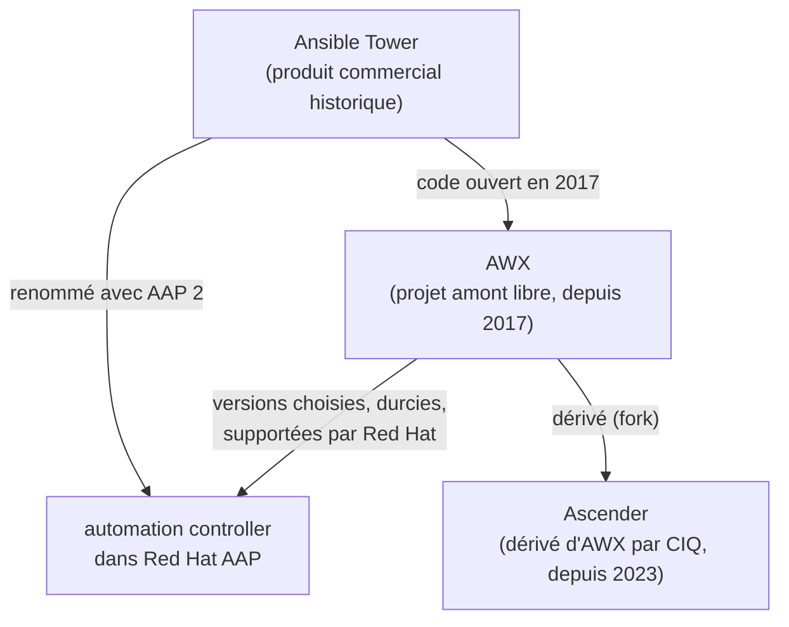

## Une lignée

Ces quatre noms partagent, au fond, le **même cœur** : le contrôleur web né avec Tower, à des
époques et sous des licences différentes. AAP est plus large, puisqu'il ajoute autour de ce
contrôleur d'autres briques (Event-Driven Ansible, un dépôt privé de collections…). Le schéma
ci-dessous montre qui descend de qui :



Voici les dates qui comptent, telles qu'on peut les vérifier au 20 octobre 2026 :

| Date | Événement |
|---|---|
| 2015 | Red Hat rachète Ansible, et avec lui **Tower**, son interface web commerciale |
| 2017 | Red Hat ouvre le code de Tower : c'est **AWX**, le projet amont libre |
| septembre 2019 | sortie de **Red Hat Ansible Automation Platform**, qui regroupe Tower et d'autres briques |
| AAP 2 (2021) | Tower est renommé **automation controller** ; les **execution environments** et **ansible-navigator** arrivent |
| juin 2023 | **Event-Driven Ansible** devient disponible dans AAP 2.4 |
| juillet 2023 | l'éditeur CIQ lance **Ascender**, une version dérivée d'AWX |
| juillet 2024 | AWX publie sa version **24.6.1**, puis suspend ses sorties le temps d'une refonte de fond |
| 2026 | Red Hat annonce la refonte d'AWX terminée, mais **aucune nouvelle version** n'est encore publiée ; Ascender, lui, sort sa 25.6.2 en septembre |

> 📖 [Dépôt AWX et son avertissement](https://github.com/ansible/awx) ·
> [AWX : la modernisation avance](https://forum.ansible.com/t/awx-modernization-moving-forward/45134) ·
> [Event-Driven Ansible est là (Red Hat)](https://www.redhat.com/en/blog/event-driven-ansible-is-here) ·
> [Ascender (CIQ)](https://github.com/ctrliq/ascender)

## Côte à côte

Ces outils partagent le même modèle : **organisations**, **projets** (un dépôt git), **inventaires**,
**identifiants** (*credentials*), **templates** de job, **plannings**, **workflows**, **droits fins**
par équipe, et une **API REST** complète. Ce qui les sépare, c'est la licence, le support et l'état
du projet :

| | **AWX** | **Tower** | **AAP** (automation controller) | **Ascender** |
|---|---|---|---|---|
| Licence | libre (Apache 2.0) | commerciale | commerciale (souscription Red Hat) | libre (Apache 2.0), offre Pro payante |
| Support | communauté | terminé : nom retiré avec AAP 2 | Red Hat | communauté, ou CIQ avec l'offre Pro |
| Installation | opérateur Kubernetes | installeur historique | installeur conteneurisé (Podman sur RHEL) ou opérateur sur OpenShift ; historiquement, un installeur RPM | installeur Ansible qui monte un k3s, ou opérateur Kubernetes |
| État en 2026 | **pas de version depuis juillet 2024**, refonte annoncée terminée | à migrer vers AAP | maintenu (2.6) | maintenu, versions régulières (25.6.2) |
| Event-Driven Ansible | à part (projet eda-server) | non | intégré | « React », dans l'installeur Kubernetes |

Deux conséquences pratiques. D'abord, un **AWX en production** tourne aujourd'hui sur une version
figée depuis juillet 2024 : rien d'alarmant à court terme, mais plus aucun correctif ne sort, et la
question de la suite se pose. Ensuite, Ascender en est la continuation libre la plus directe : même
interface, mêmes objets, même API, et même opérateur Kubernetes ; l'installeur de CIQ propose même
une [migration d'AWX vers Ascender](https://github.com/ctrliq/ascender-install). Le cas pratique de
l'étape suivante vous le montre.

## Event-Driven Ansible

Les plannings répondent à « quand ? » par une **horloge**. **Event-Driven Ansible** (EDA) y répond
par un **événement** : une alerte de supervision, un message dans une file, un webhook. Le cœur en
est un **rulebook**, un fichier YAML qui lie des **sources** d'événements à des **règles** et à des
**actions** :

```yaml
# Exemple de rulebook : relancer un service quand la supervision signale une panne
- name: Réagir aux alertes
  hosts: all
  sources:
    - ansible.eda.webhook:               # une source : écouter des requêtes HTTP sur le port 5000
        host: 0.0.0.0
        port: 5000
  rules:
    - name: Redémarrer nginx en panne
      condition: event.payload.alert == "nginx_down"     # la règle : quand l'alerte arrive…
      action:
        run_playbook:                     # …l'action : lancer un playbook
          name: playbooks/restart-nginx.yml
```

| Élément | Rôle |
|---|---|
| `sources` | d'où viennent les événements : webhook, Kafka, Prometheus Alertmanager, files de messages… |
| `rules` | les **conditions**, évaluées sur chaque événement |
| `action` | ce qui se passe quand une condition est vraie : `run_playbook`, `run_job_template` (dans un contrôleur), `debug`… |

Le moteur, **ansible-rulebook**, est un projet libre ; il demande Java, car il évalue les règles avec
le moteur Drools. Dans AAP, EDA a son propre contrôleur, qui lance des job templates de l'automation
controller ; Ascender propose l'équivalent sous le nom « React ». C'est le dernier barreau de
l'échelle du premier chapitre : on ne corrige plus seulement à l'heure dite ou au commit, mais **au
moment où le problème survient**.

> 📖 [Event-Driven Ansible](https://docs.ansible.com/projects/rulebook/) ·
> [ansible-rulebook](https://github.com/ansible/ansible-rulebook)

## Testez-vous

```quiz
title: Les plateformes — entraînement
tracksProgress: false
showNotice: false
questions:
  - prompt: Quelle est la relation entre AWX et l'automation controller d'AAP ?
    answers:
      - "Deux logiciels sans rapport"
      - "AWX est le projet amont libre ; Red Hat en choisit des versions, les durcit et les supporte dans AAP"
      - "L'automation controller est un dérivé d'Ascender"
    correct: 2
    explanation: |
      AWX est l'amont ; l'automation controller en est la version produit, supportée par Red Hat.
  - prompt: Qu'est-ce qu'Ascender par rapport à AWX ?
    answers:
      - "Un concurrent écrit de zéro"
      - "Une version dérivée d'AWX, maintenue par CIQ, avec la même interface et la même API"
      - "Le nouveau nom d'AWX après la refonte"
    correct: 2
    explanation: |
      Ascender est un fork d'AWX, maintenu par CIQ ; l'étape suivante montre qu'il en garde
      jusqu'aux noms techniques.
  - prompt: Dans un rulebook EDA, que décrit la partie rules ?
    answers:
      - "La liste des machines"
      - "Les conditions évaluées sur chaque événement, et l'action à déclencher"
      - "Les identifiants de connexion"
    correct: 2
    explanation: |
      Les sources produisent des événements ; les règles les filtrent et déclenchent des actions.
```
