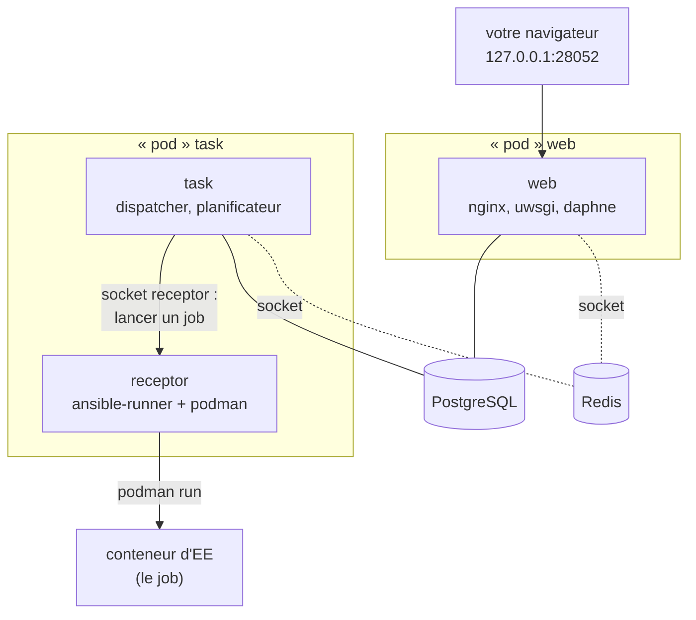
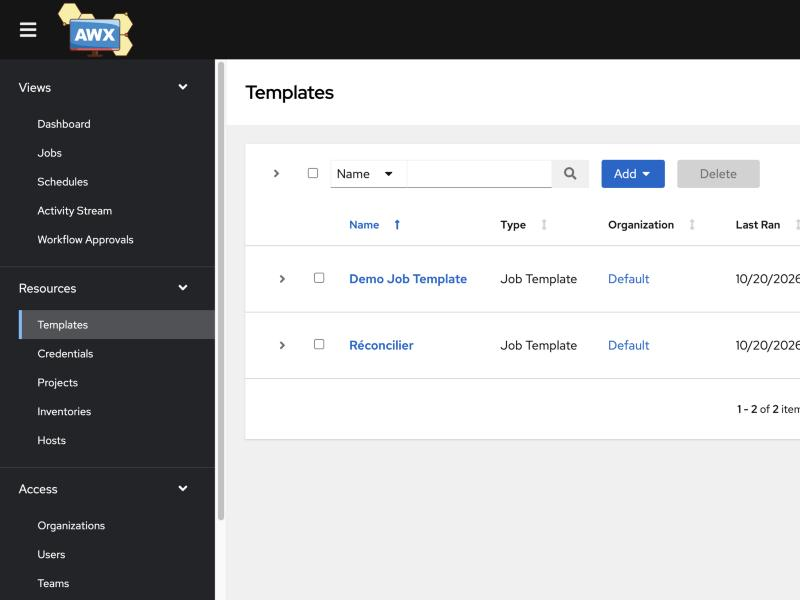
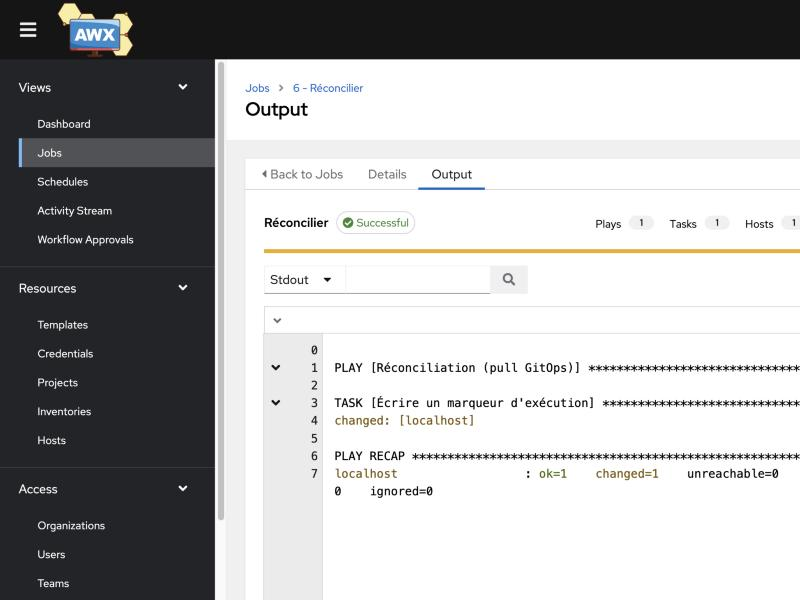

## Avant de commencer

> **⚠️ Un montage non officiel.** La seule installation supportée d'AWX passe par son opérateur
> Kubernetes. Ce cas pratique fait tourner l'image publiée `quay.io/ansible/awx:24.6.1` avec
> **Docker Compose**, en reproduisant à la main ce que fait l'opérateur. Il sert à **comprendre**
> l'architecture d'AWX et à manipuler son interface ; il ne faut pas l'utiliser en production.
>
> | Prérequis | Valeur |
> |---|---|
> | Outils | Docker avec Compose v2 |
> | Mémoire donnée à Docker | 4 Go au moins |
> | Téléchargements | environ 2 Go d'images |
> | Durée | 3 à 5 minutes |
>
> C'est l'alternative légère au cas pratique Ascender de l'étape suivante, qui lui suit la voie
> officielle, sur Kubernetes. Faites l'un, l'autre, ou les deux.

Si vous ne faites pas ce cas pratique, lisez-le, marquez l'étape comme terminée dans le sommaire, et
passez à la suite.

## L'anatomie d'AWX

Quelques mots reviennent dans cette étape :

| Notion | En une phrase |
|---|---|
| **pod**, **opérateur**, **secret** | sur Kubernetes : un groupe de conteneurs démarrés ensemble ; un programme qui installe et gère une application ; un objet qui garde une valeur sensible |
| **receptor** | le démon d'AWX qui **reçoit du travail** et l'exécute, localement ou sur d'autres machines reliées en maillage (*mesh*) |
| **dispatcher** | le répartiteur de tâches d'AWX, dans le service `task` |
| **uwsgi**, **daphne** | les serveurs Python de l'API web et des websockets, derrière nginx |
| **conteneur privilégié** | un conteneur qui a presque tous les droits de l'hôte : nécessaire ici pour faire tourner podman dedans |
| **cgroups** | le mécanisme du noyau Linux qui limite les ressources des conteneurs ; podman doit pouvoir en créer |

Sur Kubernetes, l'opérateur répartit l'essentiel d'AWX dans deux pods, *web* et *task*, plus un pod
PostgreSQL ; Redis y est un conteneur annexe de chaque pod. Le fichier
[lab/awx/compose.yml](https://github.com/byte-layers/courses-ansible-tools/blob/main/lab/awx/compose.yml)
en fait des services Compose, un par rôle :



| Service | Rôle |
|---|---|
| `perms` | démarre une seule fois : il ouvre en écriture les volumes partagés, car les conteneurs n'y écrivent pas sous le même utilisateur |
| `postgres`, `redis` | la base d'AWX, et le bus de messages interne, joint par un **socket** unix partagé dans un volume |
| `init` | une seule fois : les **migrations** du schéma, le compte `admin`, l'execution environment et les données de démonstration |
| `web` | l'interface et l'API, derrière nginx, publiées sur `127.0.0.1:28052` |
| `task` | le moteur : il répartit les jobs, tient le planning, reçoit les événements des jobs en cours |
| `receptor` | il **exécute** les jobs : `task` lui confie le travail par un socket, et il lance `ansible-runner`, qui démarre le job dans un conteneur d'**execution environment** avec **podman** |

Le schéma laisse de côté `perms` et `init`, qui s'arrêtent après leur travail. Le dernier service
est la clé : c'est la notion d'execution environment du chapitre 2, au cœur d'AWX. Sur Kubernetes,
chaque job devient un pod ; ici, chaque job devient un conteneur podman lancé **à l'intérieur** du
conteneur `receptor`. Les mises à jour de projet (le clonage du dépôt), elles, s'exécutent
directement dans le `receptor`, qui est lui-même bâti sur l'image d'EE. Pour cela, ce conteneur est **privilégié** et construit
depuis l'image `awx-ee` à laquelle on ajoute podman :
[lab/awx/receptor/Dockerfile](https://github.com/byte-layers/courses-ansible-tools/blob/main/lab/awx/receptor/Dockerfile).
Son script de démarrage,
[start-receptor.sh](https://github.com/byte-layers/courses-ansible-tools/blob/main/lab/awx/receptor/start-receptor.sh),
prépare les cgroups pour podman, et génère au premier démarrage les certificats et la clé de
signature des jobs que l'opérateur rangerait dans des secrets Kubernetes.
Le receptor monte enfin le socket de Docker, `/var/run/docker.sock` : il ne sert qu'à l'étape
suivante, pour viser des conteneurs comme au cours « premiers pas ».

Les fichiers de configuration, dans
[lab/awx/config/](https://github.com/byte-layers/courses-ansible-tools/tree/main/lab/awx/config),
sont repris de ceux que génère l'opérateur : `settings.py` et `credentials.py` (Django, la base),
`execution_environments.py` (l'image d'EE des jobs), `nginx.conf`, `redis.conf` et `receptor.conf`.

## Préparer l'atelier

Copiez le montage dans `atelier/awx/`. Deux fichiers restent à créer, qui ne doivent jamais être
versionnés : `.env`, avec les mots de passe (le modèle fourni garde les valeurs du cours), et
`config/SECRET_KEY`, la clé avec laquelle AWX chiffre les identifiants en base, tirée au hasard.

```exec
label: Copier le montage et créer les secrets
---
mkdir -p atelier/awx
cp -R lab/awx/. atelier/awx/
cp atelier/awx/.env.example atelier/awx/.env
# 32 octets aléatoires, en hexadécimal ; jamais régénérée si elle existe :
# avec une autre clé, AWX ne saurait plus déchiffrer les identifiants déjà en base
[ -s atelier/awx/config/SECRET_KEY ] || openssl rand -hex 32 > atelier/awx/config/SECRET_KEY
ls -A atelier/awx atelier/awx/config
```

```verify
d=atelier/awx
for f in compose.yml .env config/SECRET_KEY config/settings.py config/receptor.conf receptor/Dockerfile; do
  if [ ! -s "$d/$f" ]; then echo "absent ou vide : $d/$f (lancez le bloc ci-dessus)"; exit 1; fi
done
if ! docker compose -f $d/compose.yml config >/dev/null 2>&1; then echo "$d/compose.yml n'est pas valide"; exit 1; fi
echo "montage AWX prêt dans $d"
```

## Démarrer AWX

Démarrez la pile. L'option `--build` construit d'abord l'image du receptor (de 30 secondes à
quelques minutes, le temps d'installer podman), puis Compose démarre les services dans l'ordre que
fixent leurs `depends_on` : `perms`, la base et `receptor` d'abord, puis `init`, puis `web` et
`task`.

```exec
label: Démarrer AWX
---
docker compose -f atelier/awx/compose.yml -p layers-awx up -d --build
```

Le bloc suivant interroge l'API toutes les 10 secondes, et s'arrête quand l'instance d'AWX est
prête : enregistrée, de type `hybrid`, avec une capacité non nulle. Comptez une à deux minutes.

```exec
label: Attendre qu'AWX soit prêt
---
for i in $(seq 1 30); do
  etat=$(curl -s --max-time 3 http://127.0.0.1:28052/api/v2/ping/ | python3 -I -c '
import sys, json
i = json.load(sys.stdin)["instances"][0]
print(i["node_type"], "capacité", i["capacity"], "prête" if i["heartbeat"] and i["capacity"] > 0 else "en cours")' 2>/dev/null)
  echo "$(date +%T) ${etat:-API pas encore disponible}"
  case "$etat" in *prête*) exit 0 ;; esac
  sleep 10
done
echo "AWX n'est pas prêt au bout de 6 minutes : lisez docker compose -f atelier/awx/compose.yml -p layers-awx logs task"
```

La dernière ligne affiche `hybrid capacité … prête`. La **capacité** est le nombre de tâches
Ansible simultanées que l'instance accepte, calculé d'après sa mémoire et ses processeurs. Le type `hybrid` compte : un nœud AWX peut être
`control` (il pilote), `execution` (il exécute) ou `hybrid` (les deux). Sur Kubernetes, l'opérateur
crée un nœud `control`, car les jobs partent dans des pods ; ici, le service `task` s'enregistre en
`hybrid`, puisqu'il doit aussi faire exécuter les jobs.

```verify
r=$(curl -s --max-time 3 http://127.0.0.1:28052/api/v2/ping/ | python3 -I -c '
import sys, json
d = json.load(sys.stdin)
i = d["instances"][0]
print("ok" if i["heartbeat"] and i["capacity"] > 0 and i["node_type"] == "hybrid" else "pas prête")' 2>/dev/null)
if [ "$r" = "ok" ]; then echo "AWX $(curl -s --max-time 3 http://127.0.0.1:28052/api/v2/ping/ | python3 -I -c 'import sys, json; print(json.load(sys.stdin)["version"])') est prêt, instance hybrid"
else echo "AWX n'est pas encore prêt sur 127.0.0.1:28052 : relancez le bloc d'attente"; exit 1; fi
```

## Lancer le Demo Job Template

Ouvrez **http://127.0.0.1:28052** et connectez-vous avec `admin` et le mot de passe `changeme`.
Contrairement à Ascender, ce montage a préchargé des **données de démonstration** (la commande
`awx-manage create_preload_data` du service `init`) : une organisation `Default`, un *Demo Project*
qui pointe vers un dépôt d'exemples d'Ansible, un *Demo Inventory* et un *Demo Job Template*.



La capture a été prise en fin d'étape : le template `Réconcilier`, que vous créerez plus bas,
n'apparaît pas encore chez vous.

Dans **Resources > Templates**, cliquez sur la fusée de **Demo Job Template** pour le lancer. Le
premier lancement prend environ une minute : le receptor télécharge d'abord l'image d'execution
environment `awx-ee` dans son podman. Les suivants prennent une vingtaine de secondes. La sortie
se termine par :

```text
TASK [Hello Message] ***********************************************************
ok: [localhost] => {
    "msg": "Hello World!"
}
```

```verify
out=$(curl -sf --max-time 5 -u admin:changeme "http://127.0.0.1:28052/api/v2/jobs/?status=successful") \
  || { echo "AWX ne répond pas, ou le mot de passe admin n'est pas changeme"; exit 1; }
n=$(echo "$out" | python3 -I -c 'import sys, json; print(json.load(sys.stdin)["count"])')
if [ "$n" -ge 1 ]; then echo "$n job(s) réussi(s) dans AWX"
else echo "aucun job réussi pour l'instant : lancez le Demo Job Template, et attendez sa fin"; exit 1; fi
```

```hint
Le job reste longtemps en *Pending* ou *Waiting* : le receptor télécharge l'image d'EE, environ
450 Mo. Patientez. S'il échoue, lisez `docker compose -f atelier/awx/compose.yml -p layers-awx logs receptor`.
```

## Votre propre projet

Refaites maintenant avec le playbook du cours ce que vous avez fait dans Semaphore : un projet, un
inventaire, un template. Les objets et les champs sont les mêmes que dans Ascender, puisque c'est le
même logiciel, et l'étape suivante les détaille avec des tableaux :

1. **Projects > Add** : `courses-ansible-tools`, organisation `Default`, type `Git`, URL
   `https://github.com/byte-layers/courses-ansible-tools.git`, et dans le champ
   *Source Control Branch/Tag/Commit* le tag `v1` ; enregistrez, puis attendez que le statut du
   projet passe à **Successful** : la liste des playbooks n'existe qu'après cette synchronisation ;
2. **Inventories > Add > Add inventory** : `local`, organisation `Default`, puis l'hôte `localhost`
   avec la variable `ansible_connection: local` ;
3. **Templates > Add > Add job template** : `Réconcilier`, inventaire `local`, projet
   `courses-ansible-tools`, playbook `lab/semaphore/demo-repo/site.yml`.

Lancez le template. Ici, `localhost` est le conteneur d'EE démarré par podman pour ce job : le
fichier témoin `/tmp/gitops-reconcile.txt` (« réconcilié par Semaphore », le playbook vient du
chapitre précédent) y est écrit, puis disparaît avec le conteneur.



```verify
out=$(curl -sf --max-time 5 -u admin:changeme "http://127.0.0.1:28052/api/v2/jobs/?status=successful&page_size=200") \
  || { echo "AWX ne répond pas sur 127.0.0.1:28052"; exit 1; }
echo "$out" | python3 -I -c '
import sys, json
ok = [j for j in json.load(sys.stdin)["results"] if j.get("playbook") == "lab/semaphore/demo-repo/site.yml"]
if ok:
    print("job réussi avec le playbook du cours : « %s »" % ok[0]["name"])
    sys.exit(0)
print("aucun job réussi avec lab/semaphore/demo-repo/site.yml : créez et lancez le template Réconcilier")
sys.exit(1)'
```

## Ce que ce montage montre, et ce qu'il cache

Faire tourner AWX hors de Kubernetes a demandé de reconstruire à la main ce que l'opérateur fait
seul : les fichiers de configuration, l'enregistrement du nœud, les certificats du receptor, la
délégation des cgroups pour podman. Chaque correctif de ce montage est commenté dans ses fichiers ;
ils racontent pourquoi AWX a choisi Kubernetes.

| Ce que ce montage montre | Ce qu'il ne fait pas |
|---|---|
| les cinq rôles d'AWX : web, task, receptor, base, Redis | la haute disponibilité : un seul exemplaire de chaque service |
| comment un job devient un conteneur d'EE | l'isolation propre : le receptor est **privilégié** |
| les objets et l'API, identiques à AWX sur Kubernetes | les mises à jour : rien n'automatise le passage à une autre version |

En production, il vaut mieux l'opérateur AWX sur un cluster, Ascender (étape suivante), ou AAP avec
son installeur.

> **⚠️ Les raccourcis de sécurité de ce montage.** Le receptor est **privilégié**, ce qui revient à
> lui donner les droits root de la machine Docker. Les volumes partagés et la configuration du
> receptor sont ouverts en écriture à tous (`chmod 1777`, `chmod -R a+rwX`), y compris la clé
> privée de l'autorité de certification et la clé de signature des jobs. Les cookies ne sont pas
> sécurisés, `ALLOWED_HOSTS` accepte tout, et les mots de passe ont des valeurs par défaut, même
> sans fichier `.env`. Ce qui limite le risque : l'interface n'est publiée que sur `127.0.0.1`, et
> tout disparaît au nettoyage. Rien de cela ne doit sortir d'un poste de formation.

## La suite

Gardez AWX allumé : l'étape suivante, « Aller plus loin avec AWX », s'en sert et se termine par le
nettoyage. Si vous vous arrêtez ici, arrêtez AWX et supprimez ses volumes avec
`docker compose -f atelier/awx/compose.yml -p layers-awx down -v`.

```acknowledge
AWX tourne, j'ai lancé au moins un job
```
