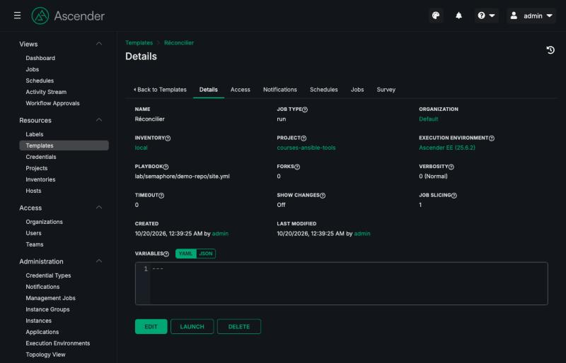
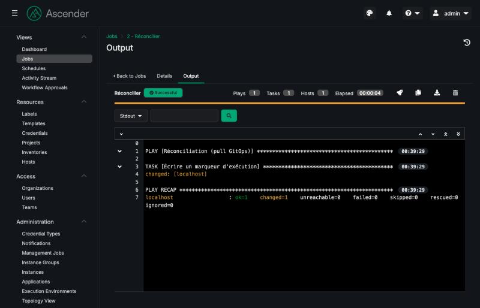

## Avant de commencer

> **⚠️ Un cas pratique plus lourd que les autres.** Ascender, comme AWX, est une application
> Kubernetes de plusieurs conteneurs. Vérifiez ces prérequis avant de vous lancer :
>
> | Prérequis | Valeur |
> |---|---|
> | Outils | `minikube`, `kubectl` et `helm`, en plus de Docker |
> | Mémoire donnée à Docker | **8 Go** au moins (réglage *Resources* de Docker Desktop) ; le cluster en prend 6 |
> | Processeurs | 4 |
> | Téléchargements | environ **5 Go** d'images, dont 2,9 Go pour la seule image d'execution environment |
> | Durée | 10 à 15 minutes d'installation, selon votre connexion |
>
> Si votre poste ne les remplit pas, lisez cette étape sans la faire : ses captures montrent ce que
> vous verriez, et le quiz final ne demande pas de l'avoir réalisée. Le cas pratique AWX en Docker
> Compose, deux étapes plus haut, en est l'alternative légère.

Ce cas pratique manipule quelques notions de Kubernetes. Voici les seules dont vous aurez besoin :

| Notion | En une phrase |
|---|---|
| **cluster**, **pod** | un ensemble de machines qui exécute des conteneurs ; un pod est un groupe de conteneurs démarrés ensemble |
| **namespace** | un compartiment du cluster ; tout ce cas pratique vit dans le namespace `ascender` |
| **Helm**, **chart** | le gestionnaire de paquets de Kubernetes ; un chart est un paquet, installé depuis un dépôt de charts |
| **opérateur**, **CRD** | un programme qui gère une application dans le cluster ; il ajoute ses propres types de ressources (*Custom Resource Definitions*), que l'on remplit pour décrire ce qu'on veut |
| **déploiement**, **service** | un déploiement fait tourner des pods et les relance s'ils tombent ; un service leur donne une adresse stable dans le cluster |
| **secret** | un objet qui contient une valeur sensible, encodée en base64 (encodée, pas chiffrée) |
| **port-forward** | un tunnel de `kubectl` qui rend un service du cluster joignable sur un port de votre poste |

Si minikube est nouveau pour vous, la page
[Démarrer avec minikube](https://minikube.sigs.k8s.io/docs/start/) explique son installation. Le
bloc ci-dessous vérifie les outils et la mémoire que Docker met à disposition.

```exec
label: Vérifier les outils et la mémoire
---
# Chaque outil, ou son absence
for outil in minikube kubectl helm docker; do
  if command -v "$outil" >/dev/null 2>&1; then echo "OK      $outil"; else echo "ABSENT  $outil"; fi
done

# La mémoire totale vue par Docker, en Go
mem=$(docker info --format '{{.MemTotal}}' 2>/dev/null)
if [ -n "$mem" ]; then
  echo "Mémoire Docker : $((mem / 1024 / 1024 / 1024)) Go"
fi
```

```verify
for outil in minikube kubectl helm docker; do
  command -v "$outil" >/dev/null 2>&1 || { echo "absent : $outil"; exit 1; }
done
mem=$(docker info --format '{{.MemTotal}}' 2>/dev/null)
if [ -z "$mem" ]; then echo "Docker ne répond pas : démarrez-le"; exit 1; fi
# Docker Desktop réserve un peu de mémoire : 7 Go visibles correspondent à 8 Go réglés
if [ "$mem" -lt 7000000000 ]; then
  echo "Docker n'a que $((mem / 1024 / 1024)) Mo : donnez-lui au moins 8 Go dans ses réglages"
  exit 1
fi
echo "outils présents, Docker dispose de $((mem / 1024 / 1024 / 1024)) Go"
```

## Démarrer le cluster

Créez un cluster minikube dédié, nommé `layers-ascender` (option `-p`, pour *profile*), avec 4
processeurs et 6 Go de mémoire. Le pilote `docker` fait tourner le cluster dans un conteneur.

```exec
label: Démarrer minikube (layers-ascender)
---
minikube start -p layers-ascender --driver=docker --cpus=4 --memory=6g
```

Le démarrage prend une à deux minutes. Notez la dernière ligne, qui contient
`kubectl is now configured to use "layers-ascender" cluster`. minikube a basculé votre contexte
`kubectl` sur ce cluster ; toutes les commandes de l'étape le désignent pourtant explicitement, avec
`--context layers-ascender`, pour ne jamais agir par erreur sur un autre cluster.

```verify
if kubectl --context layers-ascender get nodes 2>/dev/null | grep -q ' Ready '; then
  echo "cluster layers-ascender prêt"
else
  echo "le cluster layers-ascender n'est pas prêt : lancez le bloc ci-dessus, ou lisez minikube -p layers-ascender logs"
  exit 1
fi
```

## Installer l'opérateur

On n'installe pas Ascender pièce par pièce : on installe un **opérateur**, un programme qui tourne
dans le cluster et sait déployer Ascender. Vous lui décrirez ensuite l'instance voulue, et il fera
le reste : base de données, migrations, services. C'est le principe déclaratif de Kubernetes ; et
un clin d'œil au sujet du cours, puisque cet opérateur, hérité d'AWX, est lui-même **écrit en
Ansible**.

L'opérateur s'installe avec **Helm**, en version épinglée, dans un namespace `ascender` :

```exec
label: Installer l'opérateur Ascender 25.6.2
---
helm repo add ascender-operator https://ctrliq.github.io/ascender-operator
helm repo update ascender-operator
helm upgrade --install ascender-operator ascender-operator/ascender-operator \
  --version 25.6.2 --namespace ascender --create-namespace --kube-context layers-ascender
```

Regardez ce que l'opérateur a ajouté au cluster :

```exec
label: Les ressources de l'opérateur
---
kubectl --context layers-ascender get crd | grep awx.ansible.com
kubectl --context layers-ascender -n ascender get deployments
```

Surprise : les nouveaux types de ressources s'appellent `awxs`, `awxbackups`, `awxrestores`, et le
déploiement `awx-operator-controller-manager`. L'opérateur d'Ascender est celui d'AWX, repris par
CIQ ; il garde ses noms, et c'est ce qui rend la migration d'AWX vers Ascender si directe.

```verify
c=layers-ascender
if ! kubectl --context $c get crd awxs.awx.ansible.com >/dev/null 2>&1; then echo "la ressource awxs.awx.ansible.com est absente : lancez l'installation de l'opérateur"; exit 1; fi
r=$(kubectl --context $c -n ascender get deploy awx-operator-controller-manager -o jsonpath='{.status.readyReplicas}' 2>/dev/null)
if [ "$r" != "1" ]; then echo "l'opérateur n'est pas encore prêt (téléchargement de son image) : attendez une minute"; exit 1; fi
echo "opérateur installé et prêt"
```

## Décrire l'instance

L'instance se décrit dans une **ressource personnalisée** de type `AWX`. Créez le dossier
`atelier/ascender/`, puis le fichier `atelier/ascender/ascender.yml`, et complétez les trous :

🚧 **À compléter** — `atelier/ascender/ascender.yml`

```yaml
apiVersion: awx.ansible.com/v1beta1
kind:                                       # TODO : le type de ressource ajouté par l'opérateur
metadata:
  name: ascender
  namespace: ascender
spec:
  image: ghcr.io/ctrliq/ascender
  image_version:                            # TODO : la version d'Ascender, entre guillemets : "25.6.2"
  control_plane_ee_image: ghcr.io/ctrliq/ascender-ee:25.6.2
  ee_images:
    - name: Ascender EE (25.6.2)
      image: ghcr.io/ctrliq/ascender-ee:25.6.2
  postgres_image: quay.io/sclorg/postgresql-15-c9s
  postgres_image_version: "20261014"
```

| Champ | Rôle |
|---|---|
| `kind` | le type de ressource, que l'opérateur surveille |
| `metadata.name: ascender` | le nom de l'instance ; l'opérateur en dérive tous les autres : `ascender-web`, `ascender-task`, `ascender-service`, le secret `ascender-admin-password` |
| `image` et `image_version` | l'image d'Ascender, **épinglée** : sans `image_version`, l'opérateur prendrait `latest` |
| `control_plane_ee_image`, `ee_images` | l'execution environment des jobs : la notion du chapitre 2, au cœur de la plateforme |
| `postgres_image` | remplace l'image PostgreSQL par défaut, qui n'existe que pour les processeurs Intel : celle-ci tourne aussi sur un Mac Apple Silicon |

La solution de référence est dans le dépôt :
[lab/ascender/ascender.yml](https://github.com/byte-layers/courses-ansible-tools/blob/main/lab/ascender/ascender.yml).

```verify
f=atelier/ascender/ascender.yml
if [ ! -f "$f" ]; then echo "absent : $f"; exit 1; fi
if ! out=$(kubectl --context layers-ascender apply --dry-run=server -f "$f" 2>&1); then
  echo "le cluster refuse $f :"; echo "$out" | head -3; exit 1
fi
if ! grep -qE '^kind: *AWX *$' "$f"; then echo "kind doit être AWX"; exit 1; fi
if ! grep -qE 'image_version: *"25\.6\.2"' "$f"; then echo "image_version doit être \"25.6.2\", entre guillemets"; exit 1; fi
echo "ressource valide pour le cluster : $f"
```

```hint
Le type de ressource se lit dans le nom de la CRD affichée plus haut, `awxs.awx.ansible.com` : au
singulier et avec une majuscule, c'est `AWX`.
```

## Déployer et attendre

Appliquez la ressource : l'opérateur la voit et commence son travail.

```exec
label: Appliquer ascender.yml
---
kubectl --context layers-ascender apply -f atelier/ascender/ascender.yml
```

Le bloc suivant affiche l'état des pods toutes les 20 secondes, et s'arrête quand l'interface web
et le moteur de tâches sont prêts, ou au bout de 20 minutes. Vous verrez passer, dans l'ordre, la
base PostgreSQL, un job de **migration** du schéma, puis les pods `ascender-web` et `ascender-task`.

```exec
label: Suivre le déploiement
---
for i in $(seq 1 60); do
  echo "--- $(date +%T)"
  kubectl --context layers-ascender -n ascender get pods --no-headers | awk '{print "  " $1, $2, $3}'
  # Les deux déploiements sont-ils prêts ?
  web=$(kubectl --context layers-ascender -n ascender get deploy ascender-web -o jsonpath='{.status.readyReplicas}' 2>/dev/null)
  task=$(kubectl --context layers-ascender -n ascender get deploy ascender-task -o jsonpath='{.status.readyReplicas}' 2>/dev/null)
  if [ "$web" = "1" ] && [ "$task" = "1" ]; then echo "Ascender est prêt"; exit 0; fi
  sleep 20
done
echo "pas encore prêt au bout de 20 minutes : lisez kubectl --context layers-ascender -n ascender get events"
```

Pas d'inquiétude si le pod `ascender-task` reste un moment en `ImagePullBackOff` : le
téléchargement de l'image d'execution environment, 2,9 Go, a été interrompu pour avoir pris trop de
temps. Kubernetes réessaie seul, et finit par passer.

```verify
for d in ascender-web ascender-task; do
  r=$(kubectl --context layers-ascender -n ascender get deploy "$d" -o jsonpath='{.status.readyReplicas}' 2>/dev/null)
  if [ "$r" != "1" ]; then echo "$d n'est pas encore prêt : relancez le suivi du déploiement"; exit 1; fi
done
echo "ascender-web et ascender-task sont prêts"
```

## Ouvrir l'interface

L'interface est exposée par le service `ascender-service`. Le bloc ci-dessous la rend accessible sur
`127.0.0.1:28043` avec un `kubectl port-forward` lancé en arrière-plan, puis affiche le mot de
passe de l'utilisateur `admin`, que l'opérateur a généré et rangé dans un **secret** Kubernetes.

```exec
label: Ouvrir l'accès et lire le mot de passe
---
# Arrêter un éventuel port-forward précédent, puis en lancer un en arrière-plan
pkill -f "kubectl.*port-forward svc/ascender-servic[e]" || true
nohup kubectl --context layers-ascender -n ascender port-forward svc/ascender-service 28043:80 --address 127.0.0.1 \
  > atelier/ascender/port-forward.log 2>&1 &
sleep 3
echo "Interface : http://127.0.0.1:28043   utilisateur : admin"
echo "Mot de passe : $(kubectl --context layers-ascender -n ascender get secret ascender-admin-password -o jsonpath='{.data.password}' | base64 -d)"
```

Ouvrez **http://127.0.0.1:28043** et connectez-vous. Vous êtes dans l'interface d'AWX, aux couleurs
d'Ascender : **Views** (tableau de bord, jobs, plannings), **Resources** (templates, identifiants,
projets, inventaires), **Access** (organisations, utilisateurs, équipes) et **Administration**
(execution environments, groupes d'instances…).

> **⚠️ Des raccourcis de lab.** Le mot de passe s'affiche en clair dans le terminal, l'interface
> passe par un port-forward lancé à la main, et l'image PostgreSQL a été remplacée pour tourner sur
> Apple Silicon. En production, on expose Ascender par un *ingress* avec TLS, on change le mot de
> passe administrateur dès la première connexion, et on garde les images recommandées par l'éditeur.

```verify
v=$(curl -sf --max-time 3 http://127.0.0.1:28043/api/v2/ping/ 2>/dev/null | python3 -I -c 'import sys, json; print(json.load(sys.stdin)["version"])' 2>/dev/null)
if [ -n "$v" ]; then echo "Ascender $v répond sur 127.0.0.1:28043"
else echo "rien sur 127.0.0.1:28043 : relancez le bloc ci-dessus, et lisez atelier/ascender/port-forward.log"; exit 1; fi
```

## Un projet, un inventaire, un template

Ascender, contrairement à certaines versions d'AWX, ne précharge aucune donnée de démonstration. Vous
allez créer les trois objets d'un job, dans l'organisation **Default** qui existe déjà. Le projet
sera le **dépôt public de ce cours**, sur GitHub : il contient le playbook de Semaphore, que vous
rejouerez ici.

**1. Le projet.** Dans **Resources > Projects**, cliquez sur **Add** :

| Champ | Valeur |
|---|---|
| Name | `courses-ansible-tools` |
| Organization | `Default` |
| Source Control Type | `Git` |
| Source Control URL | `https://github.com/byte-layers/courses-ansible-tools.git` |
| Source Control Branch/Tag/Commit | `v1` |

Enregistrez : Ascender clone le dépôt aussitôt (une **synchronisation**), et le statut passe à
**Successful**. Il connaît alors tous les playbooks du dépôt.

**2. L'inventaire.** Dans **Resources > Inventories**, **Add** puis **Add inventory** : nommez-le
`local`, organisation `Default`, enregistrez. Ouvrez l'onglet **Hosts**, **Add**, et créez l'hôte
`localhost` avec, dans **Variables** :

```yaml
ansible_connection: local
```

**3. Le template.** Dans **Resources > Templates**, **Add** puis **Add job template** :

| Champ | Valeur |
|---|---|
| Name | `Réconcilier` |
| Inventory | `local` |
| Project | `courses-ansible-tools` |
| Playbook | `lab/semaphore/demo-repo/site.yml` (proposé dans la liste) |
| Execution Environment | `Ascender EE (25.6.2)` |

Enregistrez. La page du template récapitule tout :



Cliquez sur **Launch**. Le job s'exécute dans un **pod** créé pour l'occasion depuis l'image
d'execution environment, et sa sortie défile en direct :



Ce playbook est celui du chapitre Semaphore, d'où son nom de play et le texte qu'il écrit,
« réconcilié par Semaphore ». Ici, `localhost` désigne le **pod d'exécution** du job : le fichier
témoin y est écrit, puis disparaît avec le pod à la fin du job.

```verify
pw=$(kubectl --context layers-ascender -n ascender get secret ascender-admin-password -o jsonpath='{.data.password}' 2>/dev/null | base64 -d)
if [ -z "$pw" ]; then echo "mot de passe introuvable : le cluster tourne-t-il ?"; exit 1; fi
out=$(curl -sf --max-time 5 -u "admin:$pw" "http://127.0.0.1:28043/api/v2/jobs/?status=successful&order_by=-id") \
  || { echo "Ascender ne répond pas sur 127.0.0.1:28043 : relancez le bloc « Ouvrir l'accès et lire le mot de passe »"; exit 1; }
echo "$out" | python3 -I -c '
import sys, json
jobs = json.load(sys.stdin).get("results", [])
ok = [j for j in jobs if j.get("playbook") == "lab/semaphore/demo-repo/site.yml"]
if ok:
    print("job réussi : « %s » (n° %s), playbook lab/semaphore/demo-repo/site.yml" % (ok[0]["name"], ok[0]["id"]))
    sys.exit(0)
print("aucun job réussi avec le playbook lab/semaphore/demo-repo/site.yml : lancez le template")
sys.exit(1)
'
```

```hint
Le playbook n'apparaît pas dans la liste du template : le projet n'est pas synchronisé. Ouvrez-le
dans **Projects** et vérifiez son statut ; une faute dans l'URL ou la branche `v1` le met en échec.
```

## De Semaphore à Ascender

Vous venez de refaire, dans Ascender, ce que vous aviez fait dans Semaphore. Les objets se
correspondent presque un pour un :

| Semaphore | Ascender, AWX, AAP | Différence notable |
|---|---|---|
| Repository | **Project** | le projet se **synchronise**, et sa liste de playbooks se met à jour |
| Key Store | **Credentials** | des types d'identifiants extensibles : SSH, vault, cloud, coffres de secrets externes |
| Inventory | **Inventory** | des inventaires **dynamiques** depuis le cloud, et des groupes d'hôtes |
| Task Template | **Job Template** | des *surveys* (questions au lancement), des droits par template |
| Schedule | **Schedules** | identique |
| (exécution dans le conteneur) | **Execution environment**, dans un **pod** par job | isolation et passage à l'échelle sur le cluster |
| — | **Workflows**, **Organizations**, **Teams**, **Activity Stream** | enchaînements, multi-équipes, audit |

Ce qu'Ascender ajoute, ce sont précisément les besoins « droits » et « traçabilité » du premier
chapitre, au prix d'un cluster Kubernetes. Comme Semaphore, il se déclenche aussi par **webhook**
(option *Enable Webhook* d'un projet ou d'un template), et se pilote par son API ou par la collection
Ansible `ctrliq.ascender`. Pour AWX lui-même, la démarche est la même avec l'opérateur
AWX et l'image `quay.io/ansible/awx` ; ce cours ne l'a pas rejouée, voir la
[documentation de l'AWX Operator](https://ansible.readthedocs.io/projects/awx-operator/en/latest/installation/basic-install.html).

## Nettoyer

Arrêtez le port-forward, puis supprimez le cluster. `minikube delete` retire aussi son contexte
`kubectl`, et les 5 Go d'images téléchargées dans le cluster. Le dépôt de charts ajouté à Helm est
retiré lui aussi.

```exec
label: Supprimer le cluster layers-ascender
---
pkill -f "kubectl.*port-forward svc/ascender-servic[e]" || true
minikube delete -p layers-ascender
helm repo remove ascender-operator || true
rm -f atelier/ascender/port-forward.log
```

```verify
if minikube profile list 2>/dev/null | grep -q 'layers-ascender'; then echo "le profil layers-ascender existe encore : lancez le bloc ci-dessus"; exit 1; fi
# Le motif entre crochets évite que pgrep se trouve lui-même dans la ligne de commande de ce script
if pgrep -f "kubectl.*port-forward svc/ascender-servic[e]" >/dev/null 2>&1; then echo "le port-forward tourne encore : relancez le bloc ci-dessus"; exit 1; fi
echo "cluster layers-ascender supprimé"
```
